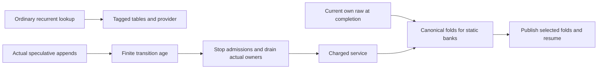

# First maintenance refinement: static bank-selective canonical publication

Question: can the already validated quiescent worker limit canonical work to
selected banks without touching the normal recurrent lookup or silently repairing
unselected state? This is a lease-family refinement, not a third CPU candidate.

The reusable C++ publication kernel accepts a seven-bit static bank mask, default
127 to preserve every existing CPU result. Zero performs no publication writes.
For each selected bank, it writes all three folds as Phi of the CURRENT own raw
at completion; it changes no raw, path, learned table, chooser or RNG. Mask5 is
the previously shortlisted static bank profile; mask3 and mask96 are controls.
Unit tests corrupt every fold and verify exact selected/unselected behavior.
This interface is not yet exposed as a new CPU experiment configuration.

Lookup retains original query timing; no additional mandatory serial query stage
is introduced. The present worker is blocking at its due boundary. Drain wait,
service latency, age/busy/timer/owner state, raw read/align, XOR/write ports,
bank-select overhead and resource conflicts all require cost and exposure.
“Fewer banks written” is not itself a measured time or energy improvement.

The current CPU prototype uses two assumed service cycles and requires no live
BPU/TAGE restore owners at start/completion. Raw SOURCE injections may occur
during service; completion recomputes from actual current raw, with injection
before publication before CPU tick. Publication does not mean raw/reference
accuracy. The default full-bank worker has already passed autonomous completion
and K2 boundary gates. The masked kernel does not replace those CPU results.

A future nonblocking variant must capture head/epoch consistently and forward,
retry or reject stale work before publication. It must account for wrong-path
updates and rollback, bound defer/starvation, charge its own ports/latches, and
test late source/fold/control faults. Do not publish a stale snapshot into current
folds or supply future outcomes/gold state. That protocol gate precedes any new
CPU sweep. B0 hash route does not qualify the worker or its clock.
